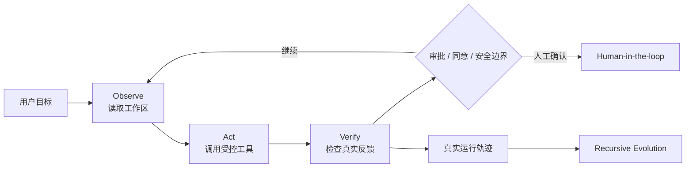
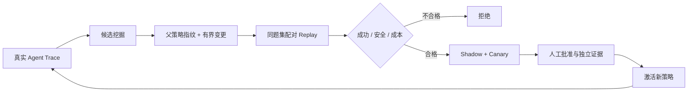

<div align="center">

# GrowthEvo

### Agent Operating System · Recursive Evolution · Causal Growth

**智能体操作系统优先 · 证据驱动的递归自进化紧随其后。**

让 Agent 在受控工作空间中真正观察、调用工具并验证结果；
让每一次可审计的操作与失败，成为下一轮策略改进的输入。

[智能体操作系统](#智能体操作系统--agent-operating-system) · [递归自进化](#递归自进化--recursive-evolution) · [Nightfall UI](#nightfall--赛博工作台) · [快速开始](#快速开始) · [因果增长](#因果增长与证据) · [架构与安全](#架构与安全边界)

</div>

---

## 智能体操作系统 · Agent Operating System

**GrowthEvo 的第一入口是 Agent OS，而不是传统报表或只能输出文字建议的聊天框。** 桌面端与移动端导航均以「智能体操作系统」「自进化中心」开头；增长驾驶舱、Campaign、实验与证据是 Agent 可以使用的业务工作空间。



模型通过 `GrowthOperator` 发起**有界、多步、结构化的工具调用**，服务端使用现有 `ToolRegistry` 检查权限和参数，随后把执行反馈交回模型。模型不能运行任意 Python / JavaScript，不能指定站外 URL，也不能自行绕过安全策略。

| 工具 | 真实能力 | 执行边界 |
| --- | --- | --- |
| `workspace.read` | 读取机会、Campaign、实验、审批、证据和运行记录 | 指定第一方数据分区，敏感决策字段过滤 |
| `page.navigate` | 请求前端打开指定站内页面 | 路由白名单；**不是**任意网页的 DOM / 坐标控制 |
| `campaign.draft` | 创建并核验 Campaign 草案 | 用户明确同意、先观察工作区；只保存 **Draft** |
| `approval.review` | 进入人工审批流程 | 请求审核，不执行审批决定 |

**内置保障：** 步数预算、重复调用拦截、受限工具参数、错误状态区分、可追踪执行步骤、草案写后核验和人工中断。模型生成 `finish` 文本本身不等于真实完成任务。

**当前边界：** 必须配置真实模型提供方才能启动实际的 Agent 工具循环；Demo 只展示样例，不伪装为真实执行。运行轨迹目前是**进程内有界记录**，尚不是可跨副本恢复的持久化任务日志。

源码入口：[`growthevo/agent_os/operator.py`](growthevo/agent_os/operator.py) · [Agent OS 架构与 API](docs/AGENT_OPERATING_SYSTEM.md)

## 递归自进化 · Recursive Evolution

第二核心能力是 **Evidence-Gated Recursive Evolution**，不是无条件地让模型修改自身源码。当前实现从真实运行轨迹中提出受限的 Operator 策略候选，然后用受控验证链判断是否值得采用。



| 环节 | 仓库已实现 | 必须保持的约束 |
| --- | --- | --- |
| 轨迹挖掘 | 至少八条实际运行轨迹才能触发候选分析 | Demo 数据不能生成真实候选 |
| 有界变更 | 可调整 Operator 步数预算、首个读取偏好 | 不修改法律动作集、因果证据校验或审批权 |
| 配对离线评测 | `PairedReplayEvaluator` 在至少 30 个不同任务上运行当前与候选策略 | 两者必须使用同一套锁定任务、隔离环境；模型自称完成不算成功 |
| 改进判定 | 检查任务成功率、违规率和调用成本代理指标 | 离线提升不等于线上因果收益 |
| 晋升门槛 | 独立评测通过后仍要求 Shadow、Canary、人工批准 | 没有给模型开放自我晋升入口 |
| 递归继承 | 获批策略成为后续候选的父节点 | 必须能追溯父策略指纹和证据 |

**正在加强的并发正确性：** 评测采用「原子认领 → 锁外执行 → 复核父策略」机制，避免耗时 Replay 阻塞实时策略读取；重复评测被拒绝，失败后安全释放认领，父策略已变更时拒绝过期结果。这项改动位于独立审查分支，是否进入 `main` 以对应 PR 合并状态为准。

**明确未实现：** 生产级持久化多租户轨迹、具备签名与独立身份的晋升证据、真实线上 Shadow / Canary 自动化工作流，以及可安全执行并审核的递归源码修改。现有 `promote` 接口的布尔条件并非线上审计证明，不能把它当作自动推广已落地。

源码入口：[`growthevo/agent_os/evolution.py`](growthevo/agent_os/evolution.py) · [`benchmark.py`](growthevo/agent_os/benchmark.py) · [详细机制](docs/AGENT_OPERATING_SYSTEM.md)

## Nightfall · 赛博工作台

**不是堆叠霓虹特效，而是为真实操作提供高可读性、低噪声、高辨识度的界面。**

- **信息层级：** Agent OS → 自进化 → 增长业务 → 证据 / 审批 / 基础设施。
- **视觉语言：** 深海军蓝底色、克制的青色焦点、统一卡片与表格、强调排版和空间秩序。
- **操作体验：** 首页 Agent 任务入口、可点击的任务建议、真实执行轨迹、证据观测面板与命令搜索。
- **跨设备：** 桌面、窄屏和移动端导航适配，支持键盘焦点提示和减少动态效果偏好。
- **数据真实性：** Demo 与实时 API 分离；真实模式下不再伪造 Agent 运行次数、进化候选或增长成绩。

设计参考 Kimi Work 的任务与对话分流、Linear 的低噪声工作台，以及 OpenAI、Anthropic 的 Agent 交互与安全原则；产品本身以**可观测执行和可验证进化**形成差异化，而非照搬其他界面。

[完整设计规范](docs/DESIGN_SYSTEM.md) · [Nightfall 样式源码](growthevo/web/static/cyber-surface.css)

> README 不再将旧浅色截图当作当前 Nightfall 实际效果图。可通过浏览器体验或 CI 生成的桌面 / 移动截图审查真实界面。

---

## 快速开始

要求 **Python 3.11+**。下面的 Demo 供本地了解产品，不调用真实模型，也不会开展外部营销动作。

```bash
git clone https://github.com/jiaweine/GrowthEvo-Harness.git
cd GrowthEvo-Harness
python -m pip install -e '.[web,dev]'
GROWTHEVO_MODE=demo growthevo-web --host 127.0.0.1 --port 8765
```

浏览器打开 **http://127.0.0.1:8765**，即可查看 Nightfall 工作台、策略、实验、审批和演示数据。

### 连接真正的 Agent 执行

以下是本地开发用的 **API 模式**，使用真实模型配置和第一方工具。请通过本机环境变量或安全密钥管理注入密钥，**不要提交到仓库**。

```bash
python -m pip install -e '.[web,llm-openai,dev]'
export GROWTHEVO_MODE=api
export OPENAI_API_KEY='your-secret-key'
export GROWTHEVO_OPENAI_MODEL='your-explicit-model-id'
growthevo-web --host 127.0.0.1 --port 8765
```

从前端 Agent 的「执行模式」提交任务，也可直接通过 API 请求：

```bash
curl -X POST http://127.0.0.1:8765/api/agent/run \
  -H 'Content-Type: application/json' \
  -d '{"goal":"读取增长机会并导航到实验中心","allow_draft_writes":false}'
```

常用接口：

| 接口 | 用途 |
| --- | --- |
| `GET /api/agent/tools` | 查看工具及作用范围 |
| `POST /api/agent/run` | 执行受控 Agent 工具循环 |
| `POST /api/agent/plan` | 只生成受约束策略建议 |
| `GET /api/harness/runs` | 查看实际 Agent 运行轨迹（Demo 时为标识明确的样例） |
| `GET /api/evolution/candidates` | 查看策略进化候选 |
| `GET /api/evolution/policy` | 查看当前 Operator 策略 |
| `GET /api/ready` | 检查运行就绪性 |

**生产部署不同于本地 API 模式：** `production` 必须激活 PostgreSQL 和有效的 OIDC/JWKS 身份验证，并采用 TLS 入口；配置字符串存在不代表组件已经激活。[自托管与安全部署指南](docs/SELF_HOSTING.md)。

### 测试

```bash
python -m pip install -e '.[dev]'
pytest tests/test_agent_operating_system.py
pytest tests/
```

GitHub Actions 同时检查 Python 多运行环境、Web 浏览器行为、移动端 Expo/TypeScript、持久化、认证、压力测试与 CodeQL。通过 CI 不代表接通了真实广告渠道或已经获得生产端进化结果。

---

## 因果增长与证据

Agent OS 操作的是已经存在的 GrowthEvo 增长与因果计算能力，不会重新造一套与业务脱节的任务系统。

| 业务空间 | 主要工作 |
| --- | --- |
| **Growth Dashboard** | 增量收入 / 利润 / ROI、渠道表现和关键待办 |
| **Opportunity Map** | 发现可能具有因果增量的受众与行动机会 |
| **Campaign Studio** | 设计目标、受众、动作、预算、创意及实验 |
| **Experiment Center** | 验证实验成熟度、处理效果与保护指标 |
| **Approval / Execution** | 人工审批、约束检查、执行记录 |
| **Evidence Center** | 支持度、反事实评估、离线/在线验证 |
| **Evolution Lab** | 进化候选、评测证据、推广门槛与策略谱系 |

**`NO_TREATMENT` 是正式动作**：不触达有时比继续营销更符合用户权益与真实增量目标。因果估计、离线策略评估（OPE）、安全策略改进、预算和同意限制由确定性业务层控制，而不是任模型修改。

### 可复核的公开数据证据

仓库包含已锁定协议的公开数据评估产物，属于增长建模能力的证据，**不是 Agent OS 或自进化带来的业绩提升**。

| 公开数据评估 | 已记录结果 | 证据 |
| --- | --- | --- |
| Criteo Uplift v2.1（上游数据集标识） | 全体人群增量访问约 **+0.94 个百分点**；所选 Top 10% 人群约 **+9.38 个百分点** | [冻结评估记录](benchmarks/targeting/results/criteo-v2.1-visit-top10/7ac26a5a/README.md) |
| Open Bandit Dataset 离线策略评估 | 支持覆盖率 **1.0000**，最终选择的验证方案为 IPS | [冻结评估记录](benchmarks/ope/results/obd-full-all-random-to-bts/7d538cea/README.md) |

这些测量结果有其特定任务、数据和评估协议，不应直接外推为真实用户业务收益。[证据方法与限制](docs/REAL_WORLD_BENCHMARKS.md)

---

## 架构与安全边界

```text
Product UI / Nightfall       -> 任务、轨迹、候选、审批与证据
Agent Operating System      -> 模型调度 + 有界 ToolRegistry + 运行轨迹
Recursive Evolution         -> 轨迹挖掘 + 配对 Replay + 证据门槛 + 策略继承
Causal Growth Runtime       -> CATE / OPE / Safe Policy Improvement / NO_TREATMENT
Deterministic Governance    -> 同意、预算、权限、审批、外部副作用限制
Production Foundations      -> PostgreSQL、OIDC、备份、恢复与 CI
```

| 已具备的能力 | 仍需进一步工程化 |
| --- | --- |
| 第一方受控 Agent 工具循环、显式草案同意、执行轨迹 | 隔离的通用浏览器执行器、持久化跨租户 Agent 任务 |
| 有界策略候选、配对离线 Replay、推广校验接口 | 独立签名证据、真实 Shadow / Canary、自动回滚 |
| PostgreSQL 业务状态、OIDC/JWKS 鉴权和恢复流程 | 分布式 Agent checkpoint / 租户隔离的进化档案 |
| Nightfall 响应式 UI、浏览器冒烟测试和移动端应用 | 大规模可用性测试、真实客户与渠道的效果验证 |

**原则：先执行与观测，再学习；先独立验证，再考虑推广。** 所有新工具、运行环境和进化机制都不得绕过同意、因果证据和人工审批。

## 设计与研究参考

- **工业实践：** [OpenAI Agents](https://developers.openai.com/api/docs/guides/agents/running-agents)、[Anthropic Building Effective Agents](https://www.anthropic.com/research/building-effective-agents)、[Microsoft Agent Framework](https://learn.microsoft.com/en-us/agent-framework/overview)、[Google ADK](https://google.github.io/adk-docs/)。
- **可验证自改进：** [Reflexion（NeurIPS）](https://papers.neurips.cc/paper_files/paper/2023/hash/1b44b878bb782e6954cd888628510e90-Abstract-Conference.html)、[SWE-agent（NeurIPS）](https://proceedings.nips.cc/paper_files/paper/2024/hash/5a7c947568c1b1328ccc5230172e1e7c-Abstract-Conference.html)、[DSPy（ICLR）](https://proceedings.iclr.cc/paper_files/paper/2024/hash/f1cf02ce09757f57c3b93c0db83181e0-Abstract-Conference.html)、[AlphaEvolve](https://deepmind.google/blog/alphaevolve-a-gemini-powered-coding-agent-for-designing-advanced-algorithms/)。
- **具体实现与边界：** [Agent OS 与自进化说明](docs/AGENT_OPERATING_SYSTEM.md) · [运行状态](docs/IMPLEMENTATION_STATUS.md) · [架构](docs/ARCHITECTURE.md) · [Nightfall 设计系统](docs/DESIGN_SYSTEM.md)。

研究资料用于指导架构、接口和评测设计，不代表本项目复现了对应论文的实验成绩。

## 参与项目

[Issues](https://github.com/jiaweine/GrowthEvo-Harness/issues) · [贡献指南](CONTRIBUTING.md) · [安全策略](SECURITY.md) · [变更记录](CHANGELOG.md)

---

<div align="center">

**GrowthEvo — Operate with evidence. Evolve with verification.**

<sub>真实操作 · 可验证自进化 · 因果增量</sub>

</div>
