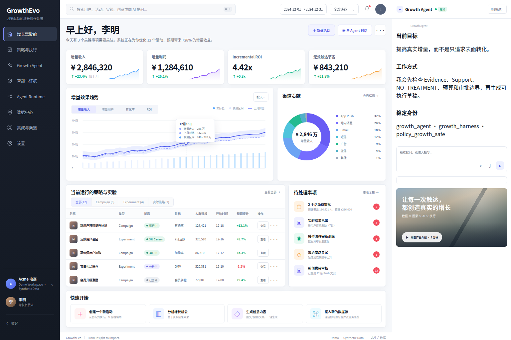
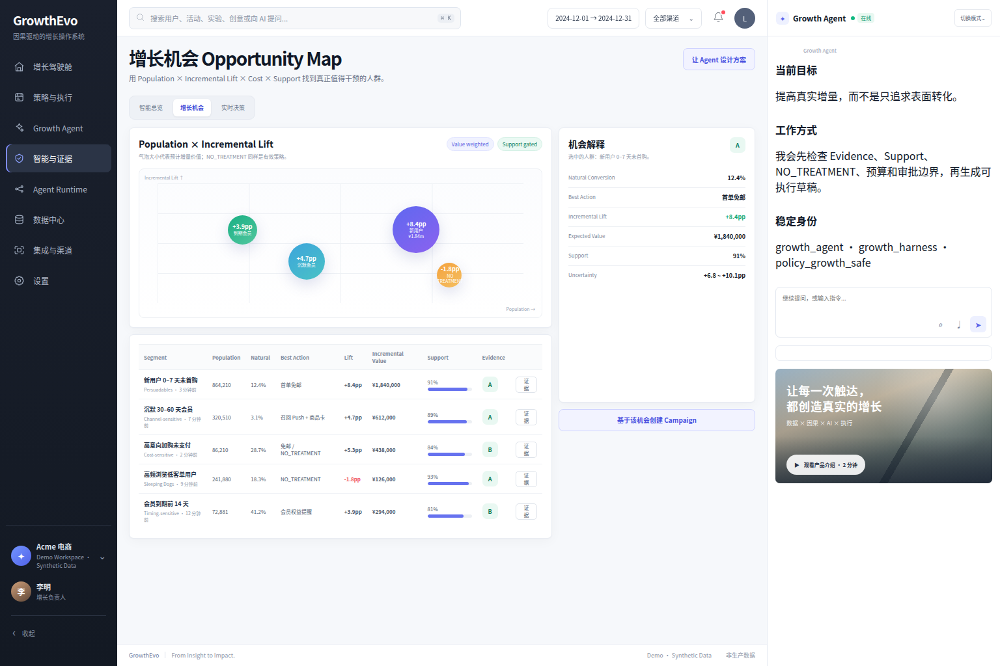
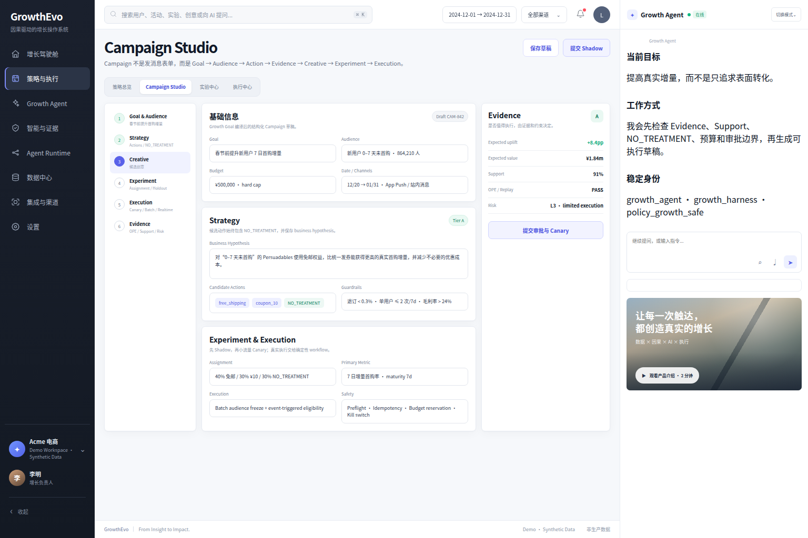
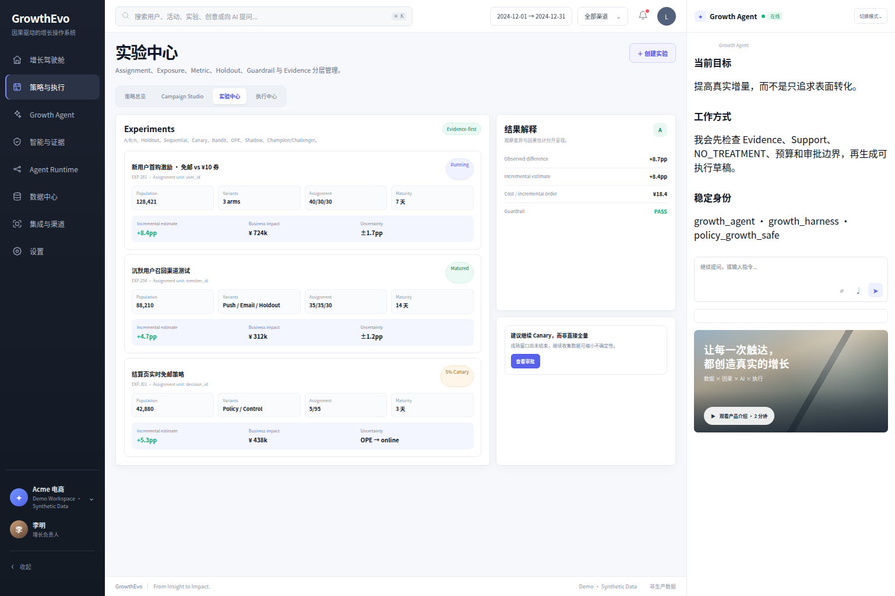
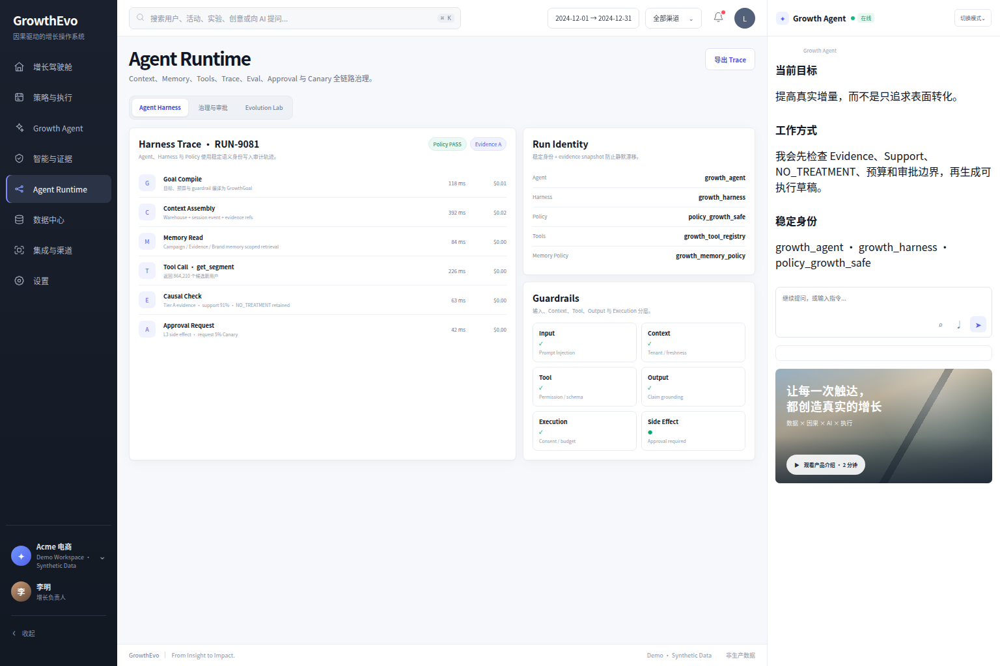
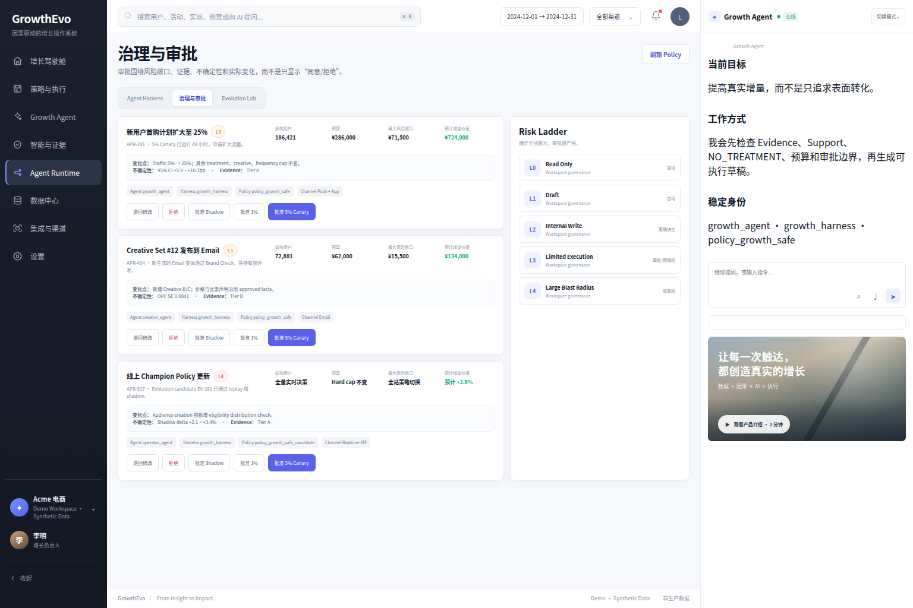
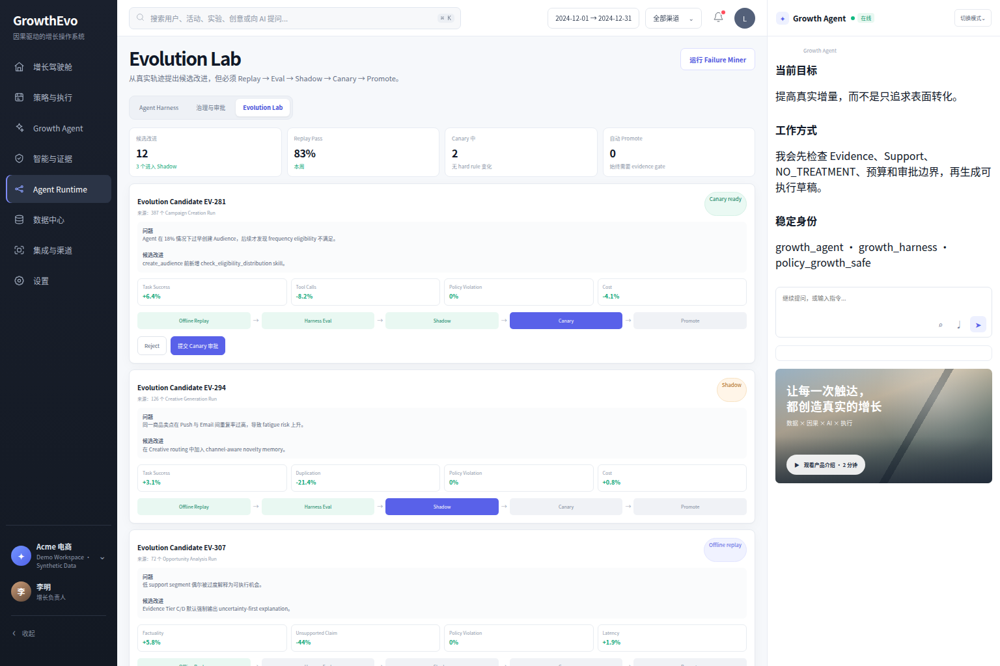
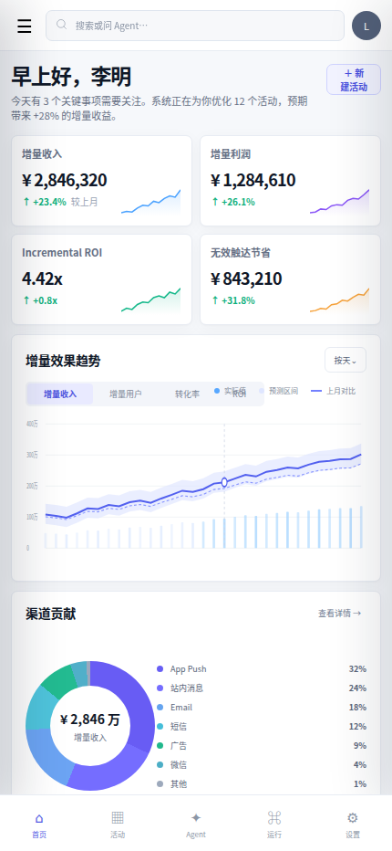

# GrowthEvo

### 因果驱动的增长操作系统

**从“谁更可能转化”走向“哪一次触达真正创造了增量”。**  
把增长机会、策略设计、实验验证、审批与执行状态放进同一个工作空间，让每一次触达都更有依据。

 

 

[产品总览](#产品总览) · [增长机会](#增长机会) · [策略与实验](#策略与实验) · [Growth Agent](#growth-agent) · [治理与进化](#治理与进化) · [效果证据](#效果证据) · [移动体验](#移动体验)

 

  

GrowthEvo 增长驾驶舱 · 从增量结果、渠道贡献到策略与待办，一屏掌握增长状态

---

## 产品总览

GrowthEvo 面向增长、生命周期、CRM、实验与智能运营团队，帮助团队回答五个真正影响结果的问题：

<table>
<tr>
<td width="20%" valign="top"><b>谁值得触达？</b> 发现高增量潜力人群，而不是只追逐高自然转化人群。</td>
<td width="20%" valign="top"><b>做什么动作？</b> 比较不同触达方式的预期增量价值、成本与风险。</td>
<td width="20%" valign="top"><b>何时不触达？</b> 把不打扰用户也当作一种正式决策，避免无效消耗。</td>
<td width="20%" valign="top"><b>结果真实吗？</b> 把实验与效果证据放进决策链路，区分相关性与真实增量。</td>
<td width="20%" valign="top"><b>如何持续变好？</b> 让每次实验、审批和执行结果反哺下一轮增长策略。</td>
</tr>
</table>

GrowthEvo 的核心体验是一条完整的增长闭环：

> **Discover → Decide → Design → Validate → Approve → Execute → Learn**

它不是单独的一张报表，也不是只会给建议的助手。你可以从机会发现开始，把人群、动作、证据、实验和后续动作连成一条清晰的增长路径。

---

## 增长机会

### Opportunity Map · 先看“真实增量”，再决定把资源投向哪里

  

Opportunity Map 把 **人群规模 × 增量提升 × 价值 × 可执行性** 放到同一张视图里。团队可以快速区分：

- 规模大、增量高，值得优先行动的机会；
- 自然转化已经很高，但继续触达价值有限的人群；
- 有潜力但需要更多证据的机会；
- 更适合保持“不触达”、避免过度营销的人群。

这样，增长资源不再只按照“谁最容易买”分配，而是围绕“哪里真的能多创造结果”分配。

---

## 策略与实验

### Campaign Studio · 把洞察变成可执行的增长方案

  

Campaign Studio 把一个增长想法拆成清晰的工作流：**目标、人群、策略、创意、实验、执行与证据**。团队可以在同一页检查预算、候选动作、边界条件和预期影响，再进入审批与验证。

这让 Campaign 不再是“先上线、再看结果”的黑盒，而是从设计阶段就带着明确假设和成功标准。

### Experiment Center · 让每个结论都有上下文

  

实验中心集中展示正在运行与已经成熟的实验：覆盖人群、分组、观察周期、增量结果、业务影响、不确定性与保护指标都放在同一上下文中。

对增长团队来说，重点不是“实验显著了吗”这一句话，而是 **这个结果是否值得继续扩大、是否需要更多观察，以及下一步应该做什么**。

---

## Growth Agent

Growth Agent 是贯穿产品的增长协作助手。它会围绕当前目标，结合机会、证据、边界与工作状态，帮助团队整理下一步动作，而不是脱离上下文给出泛化建议。

  

Growth Agent · 目标、上下文、证据、约束与行动过程保持在同一个工作空间

在 GrowthEvo 中，Agent 更像一名坐在驾驶舱里的增长搭档：

<table>
<tr>
<td width="25%" valign="top"><b>读懂目标</b> 围绕真实增量，而不是表面指标优化。</td>
<td width="25%" valign="top"><b>检查证据</b> 在提出动作前先看人群、历史结果与可信度。</td>
<td width="25%" valign="top"><b>尊重边界</b> 把预算、频次、审批和不触达选择纳入建议。</td>
<td width="25%" valign="top"><b>推动行动</b> 把建议落到 Campaign、实验和审批流程，而不是停在聊天框。</td>
</tr>
</table>

> **目标不是让 AI 替团队做决定，而是让每个决定更快、更清楚、更有依据。**

---

## 治理与进化

### 治理与审批 · 重要动作有依据，也有人把关

  

高影响增长动作不应该藏在聊天记录或零散表格里。GrowthEvo 把受众、预算、预期影响、证据与风险放在同一处，让团队在扩大动作前清楚看到 **为什么要做、影响多大、谁来确认**。

审批不是增长的刹车，而是让团队能够放心加速：低风险动作保持流畅，高影响动作进入更明确的确认路径。

### Evolution Lab · 把每一次结果变成下一轮更好的起点

  

GrowthEvo 不把一次活动结束当作终点。历史结果会进入持续复盘：哪些做法有效、哪些地方需要调整、哪些候选方案值得继续观察，都能在同一条演进路径里被追踪。

这让“复盘”不再只是写一份总结，而是把真实结果直接带进下一轮增长决策。

---

## 一套产品，覆盖完整增长节奏

| 场景 | GrowthEvo 帮你做什么 |
| --- | --- |
| **增长驾驶舱** | 聚合增量收入、增量利润、ROI、渠道贡献、运行中的策略与关键待办 |
| **机会发现** | 识别值得干预的人群，比较潜在增量与价值 |
| **策略设计** | 把目标、人群、动作、预算、创意和边界组织成完整方案 |
| **实验验证** | 跟踪分组、成熟度、增量效果、业务影响与保护指标 |
| **审批协作** | 把高影响动作进入明确的人工审批流程 |
| **实时决策** | 在具体用户与具体时刻选择更合适的动作或不触达 |
| **Growth Agent** | 基于当前上下文帮助梳理证据、方案和下一步行动 |
| **复盘与进化** | 把历史实验和决策结果沉淀为下一轮增长的输入 |

---

## 效果证据

GrowthEvo 的产品理念建立在一个简单原则上：**增长应该证明“多创造了什么”，而不只是“发生了什么”。**

在公开数据集 **Criteo Uplift v2.1** 的预先固定评估中，GrowthEvo 使用 **13,979,592** 条源数据完成目标人群评估：

<table>
<tr>
<td width="33%" align="center"><h3>+0.94 pp</h3>整体人群增量访问</td>
<td width="33%" align="center"><h3>+9.38 pp</h3>Top 10% 目标人群增量访问</td>
<td width="33%" align="center"><h3>13.98M</h3>公开数据源记录</td>
</tr>
</table>

评估过程先固定候选方案和选择规则，再进入最终结果验证，避免在看到最终答案之后反过来挑选最好看的结论。

- [查看 Criteo Uplift v2.1 增量目标评估](benchmarks/targeting/results/criteo-v2.1-visit-top10/7ac26a5a/README.md)
- [查看 Open Bandit Dataset 策略评估](benchmarks/ope/results/obd-full-all-random-to-bts/7d538cea/README.md)

---

## 移动体验

GrowthEvo 的核心驾驶舱也适配移动场景，方便在会议、通勤或活动现场快速查看关键增长状态。

<table>
<tr>
<td width="62%" valign="middle">
<h3>随时知道增长发生了什么</h3>

移动视图保留最重要的增量收入、增量利润、ROI、趋势与渠道贡献，让团队不用回到桌面端才能回答“今天增长表现怎么样”。

更适合快速查看、复盘和协作，而不是把复杂工作流硬塞进小屏幕。

</td>
<td width="38%" align="center">

</td>
</tr>
</table>

---

## 为什么是 GrowthEvo

GrowthEvo 不是把更多图表堆到增长团队面前，而是重新组织增长决策的顺序：

1. **先判断是否存在真实增量机会**，再决定是否行动；
2. **先看证据与边界**，再选择动作；
3. **把不触达视为有效选择**，减少无效营销；
4. **让实验结果直接连接下一步决策**，而不是停留在复盘文档里；
5. **让人和 Agent 在同一套上下文中协作**，保持目标、证据和执行一致。

最终希望回答的不是“我们做了多少 Campaign”，而是：

> **哪些动作真正创造了增量，为什么值得继续，以及下一次应该怎么做得更好。**

---

## 进一步了解

- [产品与项目文档](docs/)
- [真实世界评估](docs/REAL_WORLD_BENCHMARKS.md)
- [产品变更记录](CHANGELOG.md)
- [参与贡献](CONTRIBUTING.md)
- [安全说明](SECURITY.md)

---

### GrowthEvo

**From Insight to Impact.**

让每一次触达，都创造真实的增长。

